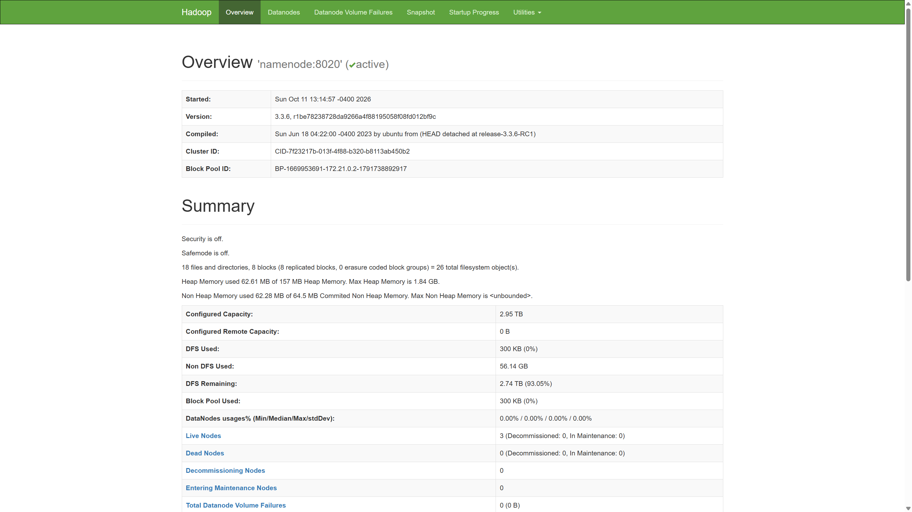
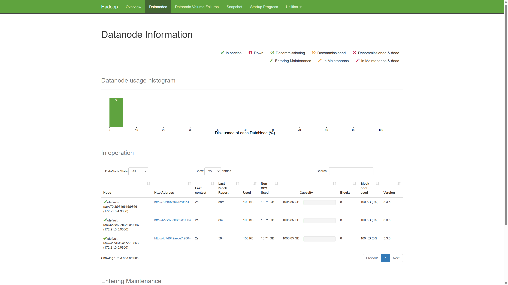
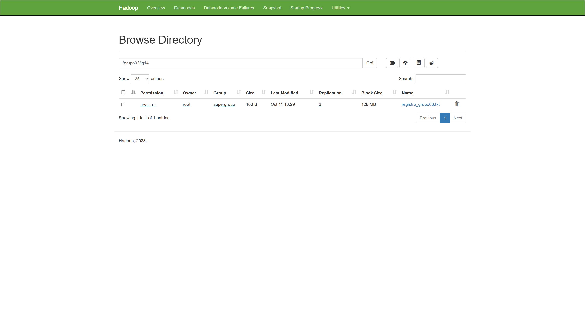
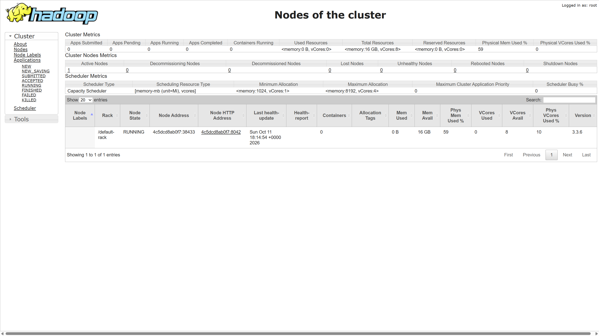
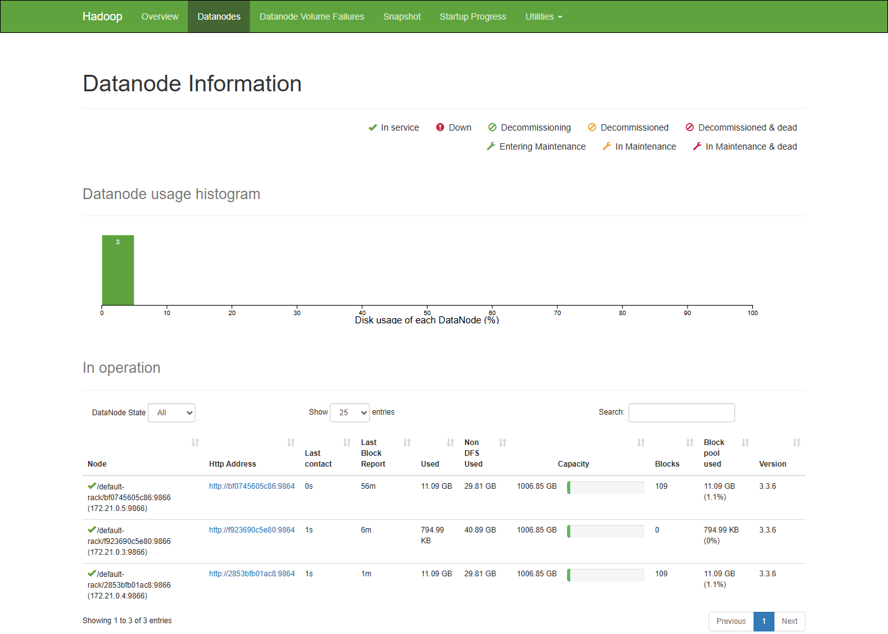
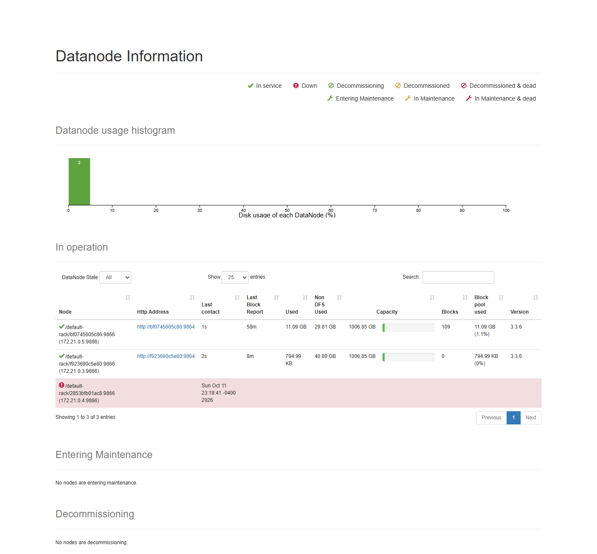
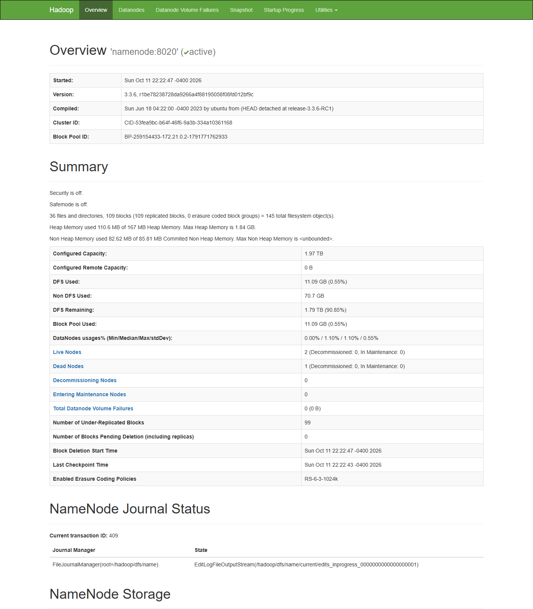
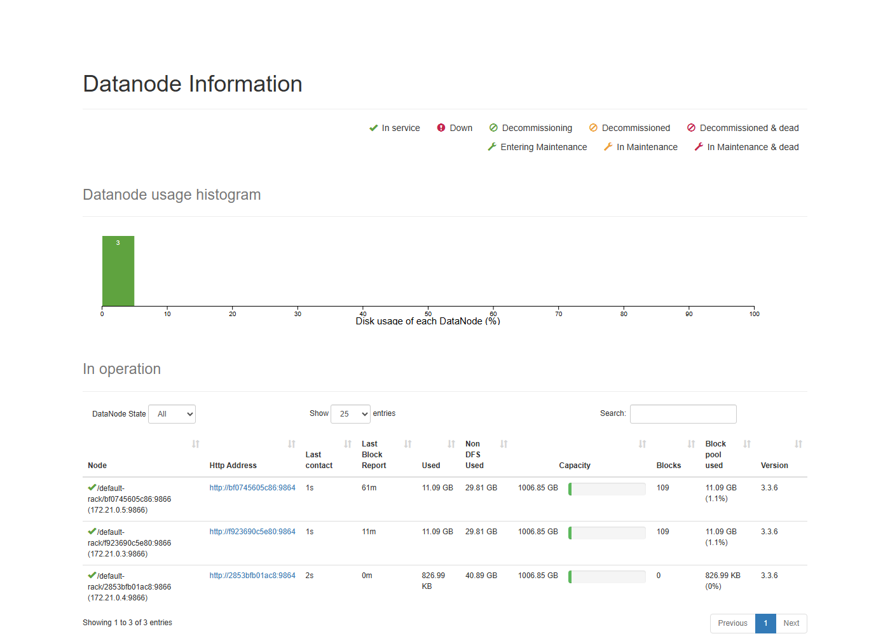

# bigdata-grupo3 — LG14 y LG15: Hadoop HDFS con Docker

**Universidad del Valle — Grupo 03**
**Integrantes:** Pantoja, Antezana, Escalera

- **LG14** (secciones 1 a 7): investigación, despliegue y prueba funcional del repositorio
  [spraharaj-projects/hadoop-environment](https://github.com/spraharaj-projects/hadoop-environment):
  un clúster **Apache Hadoop 3.3.6** multinodo (1 NameNode, 3 DataNodes, YARN e History Server)
  orquestado con **Docker Compose**. Se compara con el proyecto de referencia
  [big-data-europe/docker-hadoop](https://github.com/big-data-europe/docker-hadoop).
- **LG15** (sección 8): tolerancia a fallos y replicación en HDFS sobre el mismo clúster, con factor de
  replicación 2, datasets de 1 GB y 10 GB y la caída de un DataNode.

## Contenido del repositorio

| Ruta | Contenido |
|---|---|
| [`REGISTRO.txt`](REGISTRO.txt) | Registro del repositorio seleccionado |
| [`hadoop-environment/`](hadoop-environment/) | Archivos de configuración usados: `docker-compose.yml`, `Dockerfile` base (con correcciones), `conf/*.xml` (con replicación 2 para LG15) y `Dockerfile` + `run.sh` de cada servicio |
| [`hadoop-environment/data/`](hadoop-environment/data/) | Archivo de prueba cargado a HDFS (`registro_grupo03.txt`) |
| [`scripts/`](scripts/) | Scripts de despliegue, prueba HDFS y captura de evidencias; [`lg15.sh`](scripts/lg15.sh) para la prueba de fallo de LG15 |
| [`docs/arquitectura.md`](docs/arquitectura.md) | Diagrama y análisis detallado de la arquitectura |
| [`docs/manual-comandos.md`](docs/manual-comandos.md) | Manual paso a paso de todos los comandos, indicando dónde se ejecuta cada uno |
| [`evidencias/salidas/`](evidencias/salidas/) | Salidas reales de los comandos ejecutados (LG14) |
| [`evidencias/lg15/`](evidencias/lg15/) | Salidas de la prueba de fallo con los datasets de 1 GB y 10 GB (LG15) |
| [`evidencias/capturas/`](evidencias/capturas/) | Capturas de las interfaces web (01–04: LG14; 05–11: LG15) |

---

## 1. Información general del repositorio seleccionado

| Campo | Valor |
|---|---|
| Nombre | `hadoop-environment` |
| Autor / organización | [spraharaj-projects](https://github.com/spraharaj-projects) |
| URL | https://github.com/spraharaj-projects/hadoop-environment |
| Fecha de creación | 11/06/2024 |
| Última actualización del código | 11/06/2024 (3 commits, todos ese día) |
| Estrellas | 5 |
| Forks | 0 |
| Licencia | El README declara **Apache 2.0**, pero el repositorio no incluye archivo `LICENSE` y GitHub no detecta ninguna licencia |
| Lenguajes (GitHub) | Python 44.8 %, Dockerfile 34.6 %, Shell 20.5 % |

**Objetivo del proyecto:** ofrecer una guía paso a paso para montar, en una sola máquina con WSL2 y
Docker, un clúster Hadoop 3.3.6 multinodo que se parezca a uno real: un contenedor por cada demonio de
Hadoop, tres DataNodes y los servicios de YARN necesarios para ejecutar trabajos MapReduce.

## 2. Tecnologías

| Elemento | Detalle |
|---|---|
| Tecnología Big Data principal | Apache Hadoop: **HDFS** (almacenamiento) y **YARN + MapReduce** (procesamiento) |
| Versión | Hadoop **3.3.6** (verificado con `hadoop version`) |
| Docker | Docker Engine **29.6.1** (Docker Desktop en Windows 11) |
| Docker Compose | Compose **v5.3.0**; el archivo declara `version: "2.4"` (Compose lo ignora y avisa que es obsoleto) |
| Sistema operativo base | **Debian 12 (bookworm)**, desde la imagen `python:3.11-bookworm` |
| Java | **Eclipse Temurin OpenJDK 11.0.32** (copiado desde `eclipse-temurin:11-jdk`) |
| Bases de datos | No usa bases de datos externas. El estado del ResourceManager se guarda en HDFS (`/rmstate`) y el historial de aplicaciones en un almacén local LevelDB del History Server |
| Frameworks adicionales | YARN Timeline / Application History Server. Python 3.11 viene en la imagen base, pero Hadoop no lo usa |
| Lenguajes | Dockerfile, Bash (`run.sh`), XML (configuración de Hadoop), YAML (Compose) y Python (`project_init.py` y `project_init_2.py` solo crean la estructura de carpetas vacía a partir de `project_structure.yml`) |

## 3. Arquitectura

El diagrama completo y el análisis de cada contenedor, puerto, red, volumen, dependencia, variable de
entorno y archivo de configuración están en **[`docs/arquitectura.md`](docs/arquitectura.md)**.

Resumen:

| Contenedor | Función | Puerto en el host | Volumen |
|---|---|---|---|
| `namenode` | Maestro de HDFS (metadatos y ubicación de bloques) | 9870 (web), 8020 (RPC) | `hadoop_namenode` |
| `datanode1` | Almacena bloques de HDFS | — | `hadoop_datanode1` |
| `datanode2` | Almacena bloques de HDFS | — | `hadoop_datanode2` |
| `datanode3` | Almacena bloques de HDFS | — | `hadoop_datanode3` |
| `resourcemanager` | Maestro de YARN (asigna recursos a los trabajos) | 8089 → 8088 (web) | — |
| `nodemanager1` | Ejecuta las tareas de YARN | 8042 (web) | — |
| `historyserver` | Historial de aplicaciones YARN | 8188 (web) | `hadoop_historyserver` |

- **Contenedores:** 7, uno por demonio de Hadoop, todos con imágenes construidas localmente.
- **Red:** `hadoop_network` (bridge **externa**: hay que crearla antes de `docker compose up`).
- **Configuración:** archivos XML en `conf/`, copiados dentro de la imagen base.
- **Replicación:** en LG14 no está configurada, por lo que HDFS usa el valor por defecto (**3**) con bloques de **128 MB**.
  Para LG15 se fijó en **2** en `hdfs-site.xml` (ver [sección 8.1](#81-cambios-en-la-configuración)).

---

## 4. Instalación y ejecución

### Requisitos

- Docker Desktop con Docker Compose v2 o superior.
- Unos 6 GB libres para las imágenes y conexión a internet para el primer build (descarga Hadoop, ~700 MB).

### Paso 1 — Clonar el repositorio

Se clona con `core.autocrlf=false`. Git para Windows convierte por defecto los finales de línea a CRLF,
y los `run.sh` con CRLF hacen que los contenedores se detengan con `/bin/bash^M: bad interpreter`.

```powershell
git clone -c core.autocrlf=false https://github.com/spraharaj-projects/hadoop-environment.git
```

### Paso 2 — Ingresar al directorio

```powershell
cd hadoop-environment
```

### Paso 3 — Identificar los archivos principales

```powershell
Get-ChildItem -Force        # equivalente a: ls -la
```

| Archivo / carpeta | Rol |
|---|---|
| `docker-compose.yml` | Define los 7 servicios |
| `Dockerfile` | Imagen base `hadoop-base:3.3.6` (Java + Hadoop + configuración) |
| `conf/` | `core-site.xml`, `hdfs-site.xml`, `yarn-site.xml`, `mapred-site.xml` |
| `namenode/`, `datanode/`, `resourcemanager/`, `nodemanager/`, `historyserver/` | `Dockerfile` y `run.sh` de cada servicio |
| `start-cluster.sh` | Script original de arranque (usa el comando antiguo `docker-compose`) |
| `project_init.py`, `project_init_2.py`, `project_structure.yml` | Generan la estructura de carpetas vacía; no intervienen en el despliegue |

### Paso 4 — Analizar el archivo de Docker Compose

```powershell
Get-Content docker-compose.yml   # equivalente a: cat docker-compose.yml
```

El análisis completo del archivo está en [`docs/arquitectura.md`](docs/arquitectura.md).

### Correcciones necesarias antes de construir

El repositorio **no compila tal como está publicado**, porque dos imágenes base cambiaron desde 2024.
El grupo aplicó tres cambios al `Dockerfile` de la raíz (la versión corregida está en
[`hadoop-environment/Dockerfile`](hadoop-environment/Dockerfile)):

| Original | Corregido | Motivo |
|---|---|---|
| `FROM openjdk:11-jdk AS jdk` | `FROM eclipse-temurin:11-jdk AS jdk` | La imagen oficial `openjdk` fue retirada de Docker Hub |
| `FROM python:3.11` | `FROM python:3.11-bookworm` | `python:3.11` ahora usa Debian 13 (trixie), que ya no tiene el paquete `software-properties-common` que instala el `Dockerfile` |
| `COPY --from=jdk $JAVA_HOME $JAVA_HOME` | `COPY --from=jdk /opt/java/openjdk $JAVA_HOME` | En la imagen Temurin, Java está en `/opt/java/openjdk` y no en `/usr/local/openjdk-11` |

### Paso 5 — Construir y ejecutar

```powershell
docker network create hadoop_network
docker build -t hadoop-base:3.3.6 .
docker compose up -d --build
```

La red se crea a mano porque el Compose la declara como externa. Los mismos pasos, usando los archivos
de este repositorio, están en [`scripts/despliegue.ps1`](scripts/despliegue.ps1).

### Paso 6 — Verificar los contenedores

```powershell
docker ps
```

Resultado ([`02_docker_ps.txt`](evidencias/salidas/02_docker_ps.txt), sin las líneas de puertos IPv6):
los 7 contenedores en estado `Up (healthy)`.

```text
NAMES             IMAGE                                STATUS                    PORTS
historyserver     hadoop-environment-historyserver     Up 59 minutes (healthy)   0.0.0.0:8188->8188/tcp
nodemanager1      hadoop-environment-nodemanager1      Up 59 minutes (healthy)   0.0.0.0:8042->8042/tcp
resourcemanager   hadoop-environment-resourcemanager   Up 59 minutes (healthy)   0.0.0.0:8089->8088/tcp
datanode2         hadoop-environment-datanode2         Up 59 minutes (healthy)   9864/tcp
datanode3         hadoop-environment-datanode3         Up 59 minutes (healthy)   9864/tcp
datanode1         hadoop-environment-datanode1         Up 59 minutes (healthy)   9864/tcp
namenode          hadoop-environment-namenode          Up 59 minutes (healthy)   0.0.0.0:8020->8020/tcp, 0.0.0.0:9870->9870/tcp
```

### Paso 7 — Prueba funcional en HDFS

El archivo [`registro_grupo03.txt`](hadoop-environment/data/registro_grupo03.txt) se colocó en la
carpeta local `data/`, que el `namenode` monta en `/hadoop-data/input`.

```bash
docker exec -it namenode bash
hdfs dfs -mkdir -p /grupo03/lg14                                          # crear directorio
hdfs dfs -put /hadoop-data/input/registro_grupo03.txt /grupo03/lg14/      # cargar archivo
hdfs dfs -ls /grupo03/lg14                                                # consultar
hdfs dfs -cat /grupo03/lg14/registro_grupo03.txt                          # leer
hdfs fsck /grupo03/lg14/registro_grupo03.txt -files -blocks -locations    # bloques y réplicas
```

Los mismos comandos están en [`scripts/prueba_hdfs.sh`](scripts/prueba_hdfs.sh).

---

## 5. Resultados

### Estado del clúster

`hdfs dfsadmin -report` ([`08_hdfs_dfsadmin_report.txt`](evidencias/salidas/08_hdfs_dfsadmin_report.txt))
muestra **3 DataNodes vivos** (`Live datanodes (3)`), sin bloques perdidos, corruptos ni subreplicados.
La interfaz web del NameNode lo confirma:





### Prueba funcional HDFS

**Directorio y archivo creados** ([`09_hdfs_ls_grupo03.txt`](evidencias/salidas/09_hdfs_ls_grupo03.txt)):

```text
drwxr-xr-x   - root supergroup          0 2026-10-11 17:29 /grupo03/lg14
-rw-r--r--   3 root supergroup        106 2026-10-11 17:29 /grupo03/lg14/registro_grupo03.txt
```

**Lectura desde HDFS** ([`10_hdfs_cat_registro.txt`](evidencias/salidas/10_hdfs_cat_registro.txt)):

```text
Grupo 03 - LG14
Prueba funcional de HDFS con hadoop-environment
Integrantes: Pantoja, Antezana, Escalera
```

**Bloques y réplicas** ([`11_hdfs_fsck_registro.txt`](evidencias/salidas/11_hdfs_fsck_registro.txt), resumido y con el DataNode de cada IP anotado):

```text
/grupo03/lg14/registro_grupo03.txt 106 bytes, replicated: replication=3, 1 block(s):  OK
0. BP-1669953691-172.21.0.2-1791738892917:blk_1073741832_1008 len=106 Live_repl=3
   [DatanodeInfoWithStorage[172.21.0.3:9866,...,DISK],   <- datanode1
    DatanodeInfoWithStorage[172.21.0.5:9866,...,DISK],   <- datanode3
    DatanodeInfoWithStorage[172.21.0.4:9866,...,DISK]]   <- datanode2
Status: HEALTHY
```



### Interpretación

- El archivo de 106 bytes ocupa **1 bloque**, porque es mucho más chico que el tamaño de bloque (128 MB).
- El bloque tiene **3 réplicas vivas**, una en cada DataNode (las IPs coinciden con
  [`04_red_hadoop_network.txt`](evidencias/salidas/04_red_hadoop_network.txt)). Así se comprueba que el
  almacenamiento está distribuido.
- El factor de replicación es 3 porque, en LG14, `hdfs-site.xml` no lo define y Hadoop usa su valor por defecto.
- El NameNode solo guarda los metadatos (nombre, bloque, ubicaciones); el contenido está en los DataNodes.
- YARN tiene **1 NodeManager** activo ([`12_yarn_nodos.txt`](evidencias/salidas/12_yarn_nodos.txt)),
  con los 16 GB y 8 vCores que declara `yarn-site.xml`:



---

## 6. Comparación con big-data-europe/docker-hadoop

| Característica | docker-hadoop | hadoop-environment (seleccionado) |
|---|---|---|
| Tecnología principal | Hadoop 3.2.1 (HDFS + YARN + MapReduce) | Hadoop 3.3.6 (HDFS + YARN + MapReduce) |
| Docker | Sí, imágenes ya publicadas en Docker Hub (`bde2020/hadoop-*`, Java 8) | Sí, imágenes **construidas localmente** desde una base propia (`hadoop-base:3.3.6`, Java 11) |
| Docker Compose | Sí (`docker-compose.yml`; además `docker-compose-v3.yml` para Docker Swarm) | Sí (`docker-compose.yml` con `build:` por servicio) |
| Número de contenedores | 5: namenode, datanode, resourcemanager, nodemanager, historyserver | 7: namenode, 3 datanodes, resourcemanager, nodemanager1, historyserver |
| Almacenamiento distribuido | HDFS con **1 DataNode**: los datos no se reparten entre nodos | HDFS con **3 DataNodes**: cada bloque se replica en los tres |
| Procesamiento distribuido | YARN con 1 NodeManager | YARN con 1 NodeManager |
| Interfaces web | NameNode 9870 publicado en el host; el resto (8088, 8042, 8188, 9864) se accede por la IP del contenedor | NameNode 9870, ResourceManager 8089, NodeManager 8042 e History Server 8188 publicados en `localhost` |
| Persistencia | 3 volúmenes con nombre (namenode, datanode, historyserver) | 5 volúmenes con nombre (namenode, 3 datanodes, historyserver) + bind mounts `./data` y `./map_reduce` |
| Configuración | Variables de entorno en `hadoop.env` (`CORE_CONF_*`, `HDFS_CONF_*`), que un script convierte en XML | Archivos XML en `conf/` copiados a la imagen |
| Orden de arranque | `SERVICE_PRECONDITION`: cada servicio espera a que respondan los puertos de los que depende | `depends_on` (solo orden de arranque) + `restart: on-failure` en el ResourceManager + `HEALTHCHECK` |
| Complejidad de instalación | Baja: `docker compose up` descarga imágenes listas | Media: crear la red externa, construir la imagen base y luego el Compose. Además hubo que **corregir el `Dockerfile`** porque sus imágenes base cambiaron |
| Documentación | README breve: arranque, URLs de las interfaces y cómo configurar con variables de entorno | README tipo tutorial que repite el `Dockerfile` y el Compose, sin explicar pruebas ni configuración. Sin archivo `LICENSE` |
| Popularidad | ~2 300 estrellas, ~1 400 forks | 5 estrellas, 0 forks |
| Caso de uso | Imágenes base reutilizables: la organización las usa como base de otros proyectos (por ejemplo, `docker-hive`) | Laboratorio local para aprender cómo se reparte un clúster multinodo y ejecutar MapReduce |

**Diferencias principales.** Los dos siguen el mismo modelo, un demonio de Hadoop por contenedor, pero
con propósitos distintos. `docker-hadoop` prioriza la facilidad: imágenes listas y configuración
mediante variables, aunque con un solo DataNode, que no permite ver la replicación real. `hadoop-environment`
prioriza parecerse a un clúster real: tres DataNodes, versión más nueva de Hadoop y todas las interfaces
web publicadas. A cambio, exige construir las imágenes y depende de imágenes base externas que cambian
con el tiempo, como se vio al tener que corregir el `Dockerfile`.

---

## 7. Problemas encontrados y soluciones

| Problema | Causa | Solución |
|---|---|---|
| El build no puede descargar `openjdk:11-jdk` | La imagen `openjdk` fue retirada de Docker Hub | Usar `eclipse-temurin:11-jdk` y copiar Java desde `/opt/java/openjdk` |
| `apt-get` no encuentra el paquete `software-properties-common` | `python:3.11` pasó a Debian 13 (trixie), que ya no lo incluye | Fijar `python:3.11-bookworm` (Debian 12) |
| Riesgo de `/bin/bash^M: bad interpreter` en los `run.sh` | Git para Windows convierte los finales de línea a CRLF | Clonar con `-c core.autocrlf=false`; en este repo, `.gitattributes` fuerza LF en `*.sh` |
| `failed to read dockerfile: open Dockerfile` | `docker build` se ejecutó fuera de la carpeta del repositorio clonado | Ejecutar los comandos de Docker dentro de `hadoop-environment` |
| Aviso `the attribute version is obsolete` | Compose v2+ ya no usa el campo `version` | Solo es una advertencia; no afecta el despliegue |
| Aviso `HADOOP_PREFIX has been replaced by HADOOP_HOME` | El `Dockerfile` define la variable antigua `HADOOP_PREFIX` | Solo es una advertencia; Hadoop usa el mismo valor |
| `java: command not found` dentro del contenedor | El `Dockerfile` define `JAVA_HOME`, pero no agrega `$JAVA_HOME/bin` al `PATH` | Hadoop usa `JAVA_HOME` y funciona igual; para ver la versión se usa `$JAVA_HOME/bin/java -version` |

---

## 8. LG15 — Tolerancia a fallos y replicación de datos en HDFS

Sobre el mismo clúster de LG14 (1 NameNode y 3 DataNodes) se configuró un factor de replicación de 2,
se cargaron dos datasets, de 1 GB y de 10 GB, y se detuvo un DataNode para observar qué hace HDFS
antes, durante y después de la falla.

| DataNode | IP | Hostname (contenedor) |
|---|---|---|
| `datanode1` | 172.21.0.3 | `f923690c5e80` |
| `datanode2` | 172.21.0.4 | `2853bfb01ac8` |
| `datanode3` | 172.21.0.5 | `bf0745605c86` |

> Las horas de los archivos de evidencia están en **UTC** (reloj del contenedor). Las capturas de la
> interfaz web muestran la hora local de Bolivia (**UTC−4**).

### 8.1 Cambios en la configuración

Se agregaron dos propiedades a [`conf/hdfs-site.xml`](hadoop-environment/conf/hdfs-site.xml):

| Propiedad | Valor | Motivo |
|---|---|---|
| `dfs.replication` | `2` | Requisito de la práctica (factor ≥ 2). Sin esta propiedad Hadoop usa 3 |
| `dfs.namenode.heartbeat.recheck-interval` | `30000` (30 s) | El NameNode declara muerto a un DataNode tras `2 × recheck-interval + 10 × heartbeat` = 2 × 30 s + 10 × 3 s = **90 s**. Con el valor por defecto (5 min) serían **10,5 min** |

Como `conf/` se copia dentro de la imagen base, hay que reconstruir las imágenes:

```powershell
docker compose down -v                  # -v borra los volúmenes: HDFS arranca vacío
docker build -t hadoop-base:3.3.6 .
docker compose up -d --build
docker exec namenode hdfs getconf -confKey dfs.replication    # muestra 2
```

### 8.2 Estructura en HDFS y datasets

```bash
docker exec -it namenode bash
hdfs dfs -mkdir -p /grupo03/dataset_1GB /grupo03/dataset_10GB /grupo03/resultados /grupo03/evidencias
head -c 1G  /dev/urandom | hdfs dfs -put - /grupo03/dataset_1GB/dataset_grupo03_1GB
head -c 10G /dev/urandom | hdfs dfs -put - /grupo03/dataset_10GB/dataset_grupo03_10GB
```

Los datos aleatorios se envían directo a HDFS por la entrada estándar (`-put -`), sin crear archivos de
1 GB y 10 GB en el disco local. Resultado ([`estructura_grupo03.txt`](evidencias/lg15/estructura_grupo03.txt)),
donde el **2** de la segunda columna es el factor de replicación:

```text
drwxr-xr-x   - root supergroup           0 2026-10-12 02:55 /grupo03/dataset_10GB
-rw-r--r--   2 root supergroup 10737418240 2026-10-12 02:55 /grupo03/dataset_10GB/dataset_grupo03_10GB
drwxr-xr-x   - root supergroup           0 2026-10-12 02:40 /grupo03/dataset_1GB
-rw-r--r--   2 root supergroup  1073741824 2026-10-12 02:40 /grupo03/dataset_1GB/dataset_grupo03_1GB
drwxr-xr-x   - root supergroup           0 2026-10-12 03:24 /grupo03/evidencias
drwxr-xr-x   - root supergroup           0 2026-10-12 03:25 /grupo03/resultados
```

Las evidencias de esta práctica también se cargaron a `/grupo03/evidencias/`, y los resúmenes finales
(`*_despues.txt` y `*_esperar.txt`) a `/grupo03/resultados/`.

### 8.3 Procedimiento de la prueba de fallo

En las dos pruebas se detuvo el mismo nodo, **`datanode2`**, con `docker stop datanode2`.

**Comandos de verificación.** En cada momento se revisó lo que pide la práctica:

| Qué se verifica | Comando |
|---|---|
| Estado de los DataNodes (vivos, muertos, último contacto) | `hdfs dfsadmin -report` |
| Estado del archivo, bloques, réplicas y ubicación de cada réplica | `hdfs fsck /grupo03/dataset_1GB -files -blocks -locations` |
| Si el archivo se puede leer completo y sin cambios | `hdfs dfs -cat /grupo03/dataset_1GB/dataset_grupo03_1GB \| md5sum` |

El experimento de 1 GB se hizo con esos comandos por separado (archivos `1GB_00` a `1GB_06`). Para el de
10 GB se juntaron en el script [`scripts/lg15.sh`](scripts/lg15.sh), que guarda un resumen legible con la
cabecera `GRUPO 03` en `<dataset>_<momento>.txt`. El script se copia a `hadoop-environment/data/lg15/`,
que el `namenode` ve como `/hadoop-data/input/lg15`:

| Paso | Dónde | Comando |
|---|---|---|
| 1. Estado inicial y lectura con md5 | NameNode | `bash lg15.sh 10GB antes leer` |
| 2. Provocar la falla | PowerShell | `docker stop datanode2` |
| 3. Estado inmediatamente después | NameNode | `bash lg15.sh 10GB durante` |
| 4. Monitorear cada 5 s hasta que no queden bloques subreplicados | NameNode | `bash lg15.sh 10GB esperar` |
| 5. Estado final y lectura, con el nodo todavía caído | NameNode | `bash lg15.sh 10GB despues leer` |
| 6. Devolver el nodo y revisar | PowerShell + NameNode | `docker start datanode2` y luego `bash lg15.sh 10GB restaurado` |

Desde PowerShell, sin entrar al contenedor, se ejecuta así:

```powershell
docker exec -w /hadoop-data/input/lg15 namenode bash lg15.sh 10GB antes leer
```

### 8.4 Resultados con el dataset de 1 GB

**Antes de la falla** ([`1GB_00`](evidencias/lg15/1GB_00_md5_antes.txt),
[`1GB_01`](evidencias/lg15/1GB_01_antes_report.txt), [`1GB_02`](evidencias/lg15/1GB_02_antes_fsck.txt),
[`1GB_03`](evidencias/lg15/1GB_03_antes_replicas_por_nodo.txt)): 3 DataNodes vivos, 8 bloques de 128 MB
con 2 réplicas cada uno (16 réplicas) y md5 de referencia `5a501fddc25e4eb00b32f0038d22ddb8`.

| Bloque | Réplicas | ¿Tenía réplica en `datanode2`? |
|---|---|---|
| 0 `blk_1073741832` | datanode2, datanode1 | Sí |
| 1 `blk_1073741833` | datanode3, datanode1 | No |
| 2 `blk_1073741834` | datanode2, datanode1 | Sí |
| 3 `blk_1073741835` | datanode1, datanode3 | No |
| 4 `blk_1073741836` | datanode1, datanode2 | Sí |
| 5 `blk_1073741837` | datanode3, datanode2 | Sí |
| 6 `blk_1073741838` | datanode1, datanode2 | Sí |
| 7 `blk_1073741839` | datanode3, datanode2 | Sí |
| **Réplicas por nodo** | datanode1: 6 · datanode2: 6 · datanode3: 4 | **6 de 8 bloques afectados** |

**Durante la falla** ([`1GB_04`](evidencias/lg15/1GB_04_durante_report.txt),
[`1GB_05`](evidencias/lg15/1GB_05_durante_fsck.txt), [`1GB_06`](evidencias/lg15/1GB_06_durante_md5.txt)),
un minuto después de detener `datanode2`:

- El NameNode todavía lo listaba como vivo (`Live datanodes (3)`), pero su `Last contact` quedó congelado
  en 02:44:08 mientras los otros dos se actualizaban. Todavía no se cumplían los 90 s para declararlo muerto.
- Por eso `fsck` todavía mostraba `HEALTHY` con 0 bloques subreplicados
  ([`1GB_05`](evidencias/lg15/1GB_05_durante_fsck.txt)). Los bloques subreplicados del dataset de 1 GB y
  su re-replicación quedaron registrados en la medición de la sección 8.6
  ([`1GB_esperar`](evidencias/lg15/1GB_esperar.txt)): 7 subreplicados a los 115 s, que bajan hasta 0 a los 270 s.
- La lectura del archivo funcionó y el md5 coincidió. El log del cliente muestra cómo se salta el nodo caído:

```text
WARN hdfs.DFSClient: Failed to connect to 2853bfb01ac8:9866 for file /grupo03/dataset_1GB/dataset_grupo03_1GB
     for block ...blk_1073741832_1008, add to deadNodes and continue.
INFO hdfs.DFSClient: Successfully connected to f923690c5e80/172.21.0.3:9866 for ...blk_1073741832_1008
5a501fddc25e4eb00b32f0038d22ddb8  -
```

**Después de la recuperación** ([`1GB_despues`](evidencias/lg15/1GB_despues.txt), con `datanode2` todavía
detenido): `Status: HEALTHY`, 0 bloques subreplicados, replicación promedio 2,0 y md5 idéntico. Las
**6 réplicas nuevas** se crearon en los nodos que no tenían el bloque: 2 en `datanode1` (bloques 5 y 7)
y 4 en `datanode3` (bloques 0, 2, 4 y 6). Ahora hay 8 réplicas en cada uno.

> `1GB_despues.txt` se registró a las 03:03, cuando `datanode2` estaba detenido de nuevo por la prueba de
> 10 GB. El archivo de 1 GB ya no tenía réplicas en ese nodo desde su propia recuperación, así que la
> segunda falla no lo afectó y su distribución es la que dejó la primera.

**Nodo restaurado** ([`1GB_restaurado`](evidencias/lg15/1GB_restaurado.txt)): al volver, `datanode2`
reportó sus 6 réplicas antiguas. Esos bloques quedaron con 3 copias (sobrereplicados) y el NameNode
borró las sobrantes. El archivo quedó con 8 réplicas en `datanode1` y 8 en `datanode3`, y ninguna en
`datanode2`.

### 8.5 Resultados con el dataset de 10 GB

| Momento | Evidencia | DataNodes | Bloques subreplicados | Replicación promedio | Réplicas por nodo (dn1 / dn2 / dn3) | Lectura (md5) |
|---|---|---|---|---|---|---|
| Antes (02:55) | [`10GB_antes`](evidencias/lg15/10GB_antes.txt) | 3 vivos | 0 | 2,0 | 48 / 56 / 56 | OK `14937391c0e91ea45f020fde00fe2993` (38 s) |
| Durante, ~1 min (02:57) | [`10GB_durante`](evidencias/lg15/10GB_durante.txt) | 3 "vivos"; dn2 con `Last contact` congelado en 02:56:50 | 0 | 2,0 | 48 / 56 / 56 | — |
| Durante, ~2 min (02:58) | [`10GB_durante_recuperacion`](evidencias/lg15/10GB_durante_recuperacion.txt) | 2 vivos, **1 muerto** | **50 (62,5 %)** | 1,375 | 52 / — / 58 | — |
| Después (03:03) | [`10GB_despues`](evidencias/lg15/10GB_despues.txt) | 2 vivos, 1 muerto | 0 | 2,0 | 80 / — / 80 | OK, md5 idéntico (45 s) |
| Nodo restaurado (03:04) | [`10GB_restaurado`](evidencias/lg15/10GB_restaurado.txt) | 3 vivos | 0 | 2,0 | 80 / 0 / 80 | — |

- Antes de la falla, **56 de los 80 bloques** tenían una réplica en `datanode2`. Los otros 24 estaban en
  `datanode1` y `datanode3`. El detalle bloque por bloque está en `10GB_antes.txt`.
- A los 2 minutos el NameNode ya había declarado muerto a `datanode2`, había descontado sus réplicas y
  estaba re-replicando: 6 bloques ya tenían su segunda copia y quedaban 50. En ningún momento hubo
  bloques perdidos (`Missing blocks: 0`) y el estado siguió siendo `HEALTHY`.
- Las **56 réplicas nuevas** se repartieron en 32 para `datanode1` (48 → 80) y 24 para `datanode3` (56 → 80).
- Al restaurar `datanode2`, sus réplicas antiguas sobraban y se borraron. El nodo volvió vacío porque
  HDFS **no rebalancea automáticamente**: para repartir de nuevo los bloques se usa `hdfs balancer`.
- La cabecera de `10GB_durante_recuperacion.txt` dice "Momento: restaurado" porque se generó con ese
  argumento por error; luego se renombró el archivo según el momento real (`datanode2` seguía caído).

### 8.6 Medición del tiempo de recuperación

En las pruebas anteriores no quedó registrado el instante exacto en que los bloques subreplicados
llegaron a 0. Por eso se repitió la falla solo para medir el tiempo: se detuvo `datanode2` a las
03:13 UTC y se dejó corriendo `bash lg15.sh 1GB esperar` y `bash lg15.sh 10GB esperar` al mismo tiempo
([`1GB_esperar`](evidencias/lg15/1GB_esperar.txt), [`10GB_esperar`](evidencias/lg15/10GB_esperar.txt)).
Por las redistribuciones anteriores, en esta repetición `datanode2` tenía una réplica de **todos** los
bloques: 8 de 8 y 80 de 80.

| Segundos desde la detención | Qué pasó | 1 GB | 10 GB |
|---|---|---|---|
| 0 – 82 s | El NameNode sigue viendo 3 nodos vivos | 0 subreplicados | 0 subreplicados |
| **93 s** | `Dead datanodes (1)`: `datanode2` declarado muerto | 8 réplicas todavía asignadas al nodo caído | 80 réplicas todavía asignadas al nodo caído |
| 115 s | El NameNode descuenta las réplicas del nodo muerto | 7 subreplicados | 77 subreplicados |
| 115 – 259 s | Re-replicación: los subreplicados bajan en cada lectura | 7 → 1 | 77 → 5 |
| **270 s** | Recuperación completa | 0 | 0 |

- **Detección: 93 s**, coherente con los 90 s calculados en la sección 8.1.
- Entre los 93 s y los 115 s, `dfsadmin -report` ya mostraba el nodo como muerto, pero `fsck` seguía
  contando sus réplicas. El reporte calcula el estado en el momento, a partir del último contacto. En
  cambio, el monitor de heartbeats del NameNode, que es el que quita las réplicas del mapa de bloques y
  encola la re-replicación, corre cada `recheck-interval` (30 s).
- **Recuperación completa: 270 s (4 min 30 s)**. Se re-replicaron 88 bloques (unos 11 GB) en unos
  155 s, cerca de 0,55 bloques por segundo (~70 MB/s). El NameNode no copia todo a la vez: en cada
  iteración (cada 3 s) ordena una cantidad limitada de copias por DataNode vivo, y cada copia mueve
  128 MB entre DataNodes.
- El dataset de 1 GB terminó al mismo tiempo que el de 10 GB porque la cola de re-replicación del
  NameNode trabaja **por bloque, no por archivo**: sus 8 bloques se intercalaron con los 80 del otro
  dataset (en `1GB_esperar.txt` bajan de a uno entre los 115 s y los 270 s). A la misma velocidad, el
  dataset de 1 GB solo habría necesitado unos 15 s tras la detección (estimado, no medido).

### 8.7 Capturas de la interfaz web

Se tomaron en una repetición adicional de la falla (11/10/2026, 23:19 a 23:24 hora local), solo para
registrar la interfaz web del NameNode (http://localhost:9870). El contador de la web incluye todos los
bloques del sistema de archivos, no solo los de los datasets.

**Antes de la falla:** los 3 DataNodes en servicio. `datanode1` aparece con 0 bloques porque, tras las
pruebas anteriores, las réplicas quedaron en `datanode2` y `datanode3`. La captura
[`05_lg15_datanodes_inicial.png`](evidencias/capturas/05_lg15_datanodes_inicial.png) muestra el clúster
antes de cargar los datasets.



En el Overview, `Live Nodes: 3`, `Dead Nodes: 0` y `Number of Under-Replicated Blocks: 0`:


**Durante la falla:** `datanode2` (172.21.0.4) aparece en rojo, como caído:



En el Overview aparecen `Dead Nodes: 1` y `Number of Under-Replicated Blocks: 99`:



**Después de la recuperación:** `datanode2` sigue caído, pero los bloques subreplicados volvieron a 0
([`10_lg15_overview_recuperado.png`](evidencias/capturas/10_lg15_overview_recuperado.png)).

**Nodo restaurado:** `datanode2` vuelve con **0 bloques** y los otros dos tienen 109 cada uno. Así se
comprueba que HDFS no rebalancea automáticamente:



### 8.8 Análisis

| Pregunta | Dataset de 1 GB | Dataset de 10 GB |
|---|---|---|
| **Antes:** ¿cuántos bloques tenía el archivo? | 8 | 80 |
| ¿Cuántas réplicas tenía cada bloque? | 2 (`Live_repl=2`) | 2 |
| ¿En qué DataNodes estaban? | En los tres: datanode1 6, datanode2 6, datanode3 4 (detalle en la sección 8.4) | En los tres: datanode1 48, datanode2 56, datanode3 56 |
| **Durante:** ¿qué DataNode fue detenido? | `datanode2` (172.21.0.4) | `datanode2` (172.21.0.4) |
| ¿Qué bloques estaban almacenados en él? | 6 de 8: los bloques 0, 2, 4, 5, 6 y 7 | 56 de 80 |
| ¿Existían otras réplicas? | Sí: cada bloque tenía su otra réplica en `datanode1` o `datanode3` | Sí, para los 56 bloques |
| ¿El archivo continuó disponible? | Sí: lectura completa con md5 idéntico. El cliente falló al conectar con `datanode2` y leyó de `datanode1` | Sí: lectura completa con md5 idéntico con `datanode2` caído |
| ¿Qué cambió en HDFS? | Durante ~90 s solo se congeló el `Last contact` del nodo. Luego pasó a `Dead`, sus réplicas se descontaron y los bloques afectados quedaron subreplicados | Lo mismo: a los 2 minutos había 50 bloques subreplicados y la replicación promedio bajó a 1,375 |
| **Después:** ¿qué estado reporta HDFS? | `HEALTHY`, replicación promedio 2,0, 0 bloques perdidos | `HEALTHY`, replicación promedio 2,0, 0 bloques perdidos |
| ¿Existen bloques subreplicados? | No, 0 | No, 0 |
| ¿HDFS intenta recuperar automáticamente las réplicas? | Sí, sin ninguna intervención | Sí, sin ninguna intervención |
| ¿En qué DataNode se generaron las nuevas réplicas? | 2 en `datanode1` y 4 en `datanode3` | 32 en `datanode1` y 24 en `datanode3` |

**Por qué ocurrió.** El NameNode guarda el mapa de bloques: qué bloques forman cada archivo y en qué
DataNodes está cada réplica. Cada DataNode le envía un *heartbeat* cada 3 s y, periódicamente, la lista de
bloques que tiene. Cuando `datanode2` dejó de enviar heartbeats, el NameNode esperó el plazo configurado
(90 s) y lo declaró muerto. Entonces quitó sus réplicas del mapa, y los bloques que quedaron con menos
réplicas que el factor configurado entraron a la cola de re-replicación. Para cada uno, el NameNode le
ordenó a un DataNode que tenía la réplica sana copiarla a otro DataNode que no tuviera ese bloque. Con
3 nodos, uno caído y factor 2, el destino es siempre el único nodo vivo que no tiene el bloque. Por eso
el bloque 0 (datanode2 + datanode1) recibió su nueva réplica en `datanode3`, y el bloque 5
(datanode3 + datanode2) en `datanode1`. Mientras tanto, el cliente nunca perdió acceso: le pide al
NameNode las ubicaciones de cada bloque y, si una réplica no responde, lee la otra.

### 8.9 Preguntas para la exposición

**1. ¿Por qué HDFS puede continuar proporcionando el archivo aunque un DataNode haya fallado?**
Porque cada bloque tiene 2 réplicas en DataNodes distintos: HDFS nunca pone dos réplicas del mismo bloque
en el mismo nodo. Al leer, el cliente recibe del NameNode la lista de ubicaciones de cada bloque y, si una
falla, usa la siguiente. Se ve en `1GB_06_durante_md5.txt`: `Failed to connect to 2853bfb01ac8:9866 ...
add to deadNodes and continue`, seguido de `Successfully connected to f923690c5e80`, y el md5 es idéntico.

**2. ¿Qué habría ocurrido si el factor de replicación hubiera sido 1?**
Cada bloque existiría en un solo DataNode. Al caer `datanode2`, los bloques que solo estaban ahí
(aproximadamente un tercio) habrían quedado como *missing* y `fsck` habría marcado el archivo como
`CORRUPT`. La lectura habría fallado al llegar al primero de esos bloques (`BlockMissingException`).
Tampoco habría re-replicación, porque no queda ninguna copia de origen. Los datos solo volverían si el
nodo regresa con su disco intacto.

**3. ¿Qué habría ocurrido si hubieran fallado dos DataNodes simultáneamente?**
Con factor 2, los bloques que tenían sus dos réplicas justo en esos dos nodos se habrían perdido y el
archivo no se podría leer completo. Con la distribución inicial del dataset de 1 GB: si fallaban
`datanode1` y `datanode2`, se perdían 4 de 8 bloques (0, 2, 4 y 6); con `datanode2` y `datanode3`, 2
bloques (5 y 7); y con `datanode1` y `datanode3`, otros 2 (1 y 3). Los bloques restantes seguirían
legibles con una sola réplica, pero quedarían subreplicados de forma permanente: con un solo nodo vivo no
hay un segundo nodo donde poner la otra copia. Si la segunda falla llega **después** de que terminó la
re-replicación, no se pierde nada, porque los dos nodos restantes ya tienen todos los bloques. Por eso
importa el tiempo de recuperación.

**4. ¿Por qué un factor de replicación de 2 no significa necesariamente que existan dos copias completas del archivo en dos DataNodes?**
Porque la replicación es **por bloque, no por archivo**: la ubicación de las 2 réplicas de cada bloque se
decide por separado. Antes de la falla, ningún DataNode tenía el archivo de 1 GB completo (6, 6 y 4 de
los 8 bloques). El archivo solo existe completo como la unión de los bloques repartidos en el clúster.
Lo que garantiza el factor 2 es que cada bloque tiene 2 copias en 2 nodos distintos.

**5. ¿Cuál es la relación entre tamaño de bloque y número de bloques?**
Número de bloques = tamaño del archivo ÷ tamaño de bloque, redondeado hacia arriba. Con bloques de 128 MB:
1 GB ÷ 128 MB = **8** bloques y 10 GB ÷ 128 MB = **80** bloques; el último bloque puede ser más chico. Un
bloque más grande produce menos bloques, menos metadatos en el NameNode y menos paralelismo; uno más
chico, lo contrario. Un archivo menor que un bloque ocupa 1 bloque solo de su tamaño real: el archivo de
106 bytes de LG14 no ocupa 128 MB en disco.

**6. ¿Por qué el dataset de 10 GB permite observar un comportamiento más representativo de un sistema distribuido que el dataset de 1 GB?**
Porque tiene 10 veces más bloques (80 frente a 8). El reparto entre nodos se acerca a lo que hace HDFS a
gran escala (48 / 56 / 56 frente a 6 / 6 / 4), y la caída afecta a muchos bloques a la vez (56). La
re-replicación dura lo suficiente para verla avanzar: 50 subreplicados a los 2 minutos, que bajan poco a
poco. Con 1 GB todo ocurre en segundos y con muy pocos bloques. También se nota el costo de mover datos
entre nodos: la lectura completa tarda 38–45 s frente a 7 s.

**7. ¿Qué sucede con los bloques que tenían una réplica en el DataNode que falló?**
Durante los primeros ~90 s, nada: el NameNode todavía no sabe que el nodo cayó. Al declararlo muerto,
descuenta esas réplicas y los bloques quedan subreplicados, pero siguen disponibles con su otra réplica.
Luego el NameNode ordena copiarlos desde la réplica sana a otro nodo, hasta volver a 2. Si el nodo caído
regresa, reporta sus réplicas antiguas; esos bloques quedan con 3 copias y el NameNode borra las
sobrantes. En nuestras pruebas, a veces borró las del nodo que volvió y otras las de otro nodo, según su
política de elección. HDFS no vuelve a repartir los bloques por su cuenta.

**8. ¿Quién administra la ubicación y replicación de los bloques: el cliente, el DataNode o el NameNode?**
El **NameNode**. Al escribir, decide en qué DataNodes va cada réplica. Además, mantiene el mapa de
ubicaciones, detecta los nodos muertos por falta de heartbeats y ordena las re-replicaciones y los
borrados de réplicas sobrantes. El cliente solo le pide las ubicaciones y luego lee o escribe los datos
directamente con los DataNodes. Los DataNodes guardan los bloques, envían heartbeats y reportes de
bloques, y ejecutan las copias que les ordena el NameNode.

**9. ¿Qué diferencia existe entre disponibilidad del archivo y cumplimiento del factor de replicación después de una falla?**
**Disponibilidad** significa que se puede leer el archivo completo: basta con que cada bloque tenga al
menos 1 réplica viva. **Cumplimiento del factor** significa que cada bloque tiene las 2 réplicas
configuradas. Durante la falla de 10 GB el archivo estaba **disponible**, pero **no cumplía el factor**:
`10GB_durante_recuperacion.txt` muestra 50 bloques subreplicados, replicación promedio 1,375, y aun así
`Status: HEALTHY`. `fsck` solo marca `CORRUPT` cuando faltan bloques. Tras la re-replicación se cumplen
las dos condiciones. Mientras no se cumple el factor, una segunda falla sí podría causar pérdida de datos.

### 8.10 Comparación entre ambos experimentos

| Característica | Dataset 1 GB | Dataset 10 GB |
|---|---|---|
| Tamaño | 1 GB (1 073 741 824 bytes) | 10 GB (10 737 418 240 bytes) |
| Número de bloques | 8 de 128 MB | 80 de 128 MB |
| Factor de replicación | 2 (16 réplicas en total) | 2 (160 réplicas en total) |
| DataNode afectado | `datanode2` (172.21.0.4) | `datanode2` (172.21.0.4) |
| Bloques afectados | 6 de 8 (75 %) en la prueba principal; 8 de 8 en la repetición de la sección 8.6 | 56 de 80 (70 %) en la prueba principal; 80 de 80 en la repetición de la sección 8.6 |
| Bloques disponibles después de la falla | 8 de 8 (0 perdidos) | 80 de 80 (0 perdidos) |
| ¿Archivo accesible? | Sí, md5 idéntico (lectura de 7 s) | Sí, md5 idéntico (lectura de 38–45 s) |
| ¿Existieron bloques subreplicados? | Sí: hasta 7 de 8 en la repetición de la sección 8.6 (`1GB_esperar.txt`), en cuanto el NameNode descontó las réplicas del nodo muerto | Sí: 50 (62,5 %) a los 2 min en la prueba principal; hasta 77 de 80 en la repetición de la sección 8.6 |
| Tiempo de recuperación | Detección a los 93 s y recuperación completa a los 270 s, compartiendo la cola con el dataset de 10 GB (solo habría tardado ~15 s tras la detección, estimado) | Detección a los 93 s y recuperación completa a los 270 s (4 min 30 s) |
| Nuevas réplicas | 6: 2 en `datanode1` y 4 en `datanode3` | 56: 32 en `datanode1` y 24 en `datanode3` |

**Conclusión.** En los dos casos HDFS mantuvo el archivo disponible y sin pérdida de datos, porque cada
bloque afectado tenía su otra réplica en un nodo vivo. Además, recuperó el factor de replicación sin
intervención. La diferencia está en la escala: con 10 GB, la falla afecta a decenas de bloques y la
re-replicación se puede observar avanzando. Los dos datasets compiten por la misma cola de
re-replicación del NameNode.

### 8.11 Evidencias de LG15

| Archivo | Contenido |
|---|---|
| [`1GB_00_md5_antes.txt`](evidencias/lg15/1GB_00_md5_antes.txt) | md5 de referencia del dataset de 1 GB |
| [`1GB_01_antes_report.txt`](evidencias/lg15/1GB_01_antes_report.txt), [`1GB_02_antes_fsck.txt`](evidencias/lg15/1GB_02_antes_fsck.txt), [`1GB_03_antes_replicas_por_nodo.txt`](evidencias/lg15/1GB_03_antes_replicas_por_nodo.txt) | 1 GB antes de la falla: DataNodes, bloques y réplicas por nodo |
| [`1GB_04_durante_report.txt`](evidencias/lg15/1GB_04_durante_report.txt), [`1GB_05_durante_fsck.txt`](evidencias/lg15/1GB_05_durante_fsck.txt), [`1GB_06_durante_md5.txt`](evidencias/lg15/1GB_06_durante_md5.txt) | 1 GB durante la falla, con la lectura que salta el nodo caído |
| [`1GB_despues.txt`](evidencias/lg15/1GB_despues.txt), [`1GB_restaurado.txt`](evidencias/lg15/1GB_restaurado.txt) | 1 GB después de la recuperación y con el nodo devuelto |
| [`10GB_antes.txt`](evidencias/lg15/10GB_antes.txt), [`10GB_durante.txt`](evidencias/lg15/10GB_durante.txt), [`10GB_durante_recuperacion.txt`](evidencias/lg15/10GB_durante_recuperacion.txt), [`10GB_despues.txt`](evidencias/lg15/10GB_despues.txt), [`10GB_restaurado.txt`](evidencias/lg15/10GB_restaurado.txt) | 10 GB en cada momento de la falla |
| [`1GB_esperar.txt`](evidencias/lg15/1GB_esperar.txt), [`10GB_esperar.txt`](evidencias/lg15/10GB_esperar.txt) | Medición del tiempo de detección y de recuperación |
| [`estructura_grupo03.txt`](evidencias/lg15/estructura_grupo03.txt) | Estructura de `/grupo03` en HDFS |
| [`evidencias/capturas/05`–`11`](evidencias/capturas/) | Interfaz web del NameNode antes, durante y después de la falla |

### 8.12 Problemas encontrados en LG15

| Problema | Causa | Solución |
|---|---|---|
| El `namenode` se detiene con `Illegal to have multiple roots` | Las propiedades nuevas quedaron antes de `<configuration>` en `hdfs-site.xml` | Moverlas dentro de `<configuration>`, reconstruir la imagen base y volver a levantar el clúster |
| Justo después del `docker stop`, HDFS sigue mostrando 3 nodos vivos | El NameNode espera 90 s sin heartbeats antes de declarar muerto un nodo | Es el comportamiento esperado; `lg15.sh esperar` registra el momento exacto |
| El nodo aparece como muerto, pero `fsck` sigue contando sus réplicas | El monitor que descuenta las réplicas corre cada 30 s | `lg15.sh esperar` solo termina cuando no quedan réplicas en el nodo caído y no hay subreplicados |
| Tras restaurar un nodo, una nueva falla de ese nodo no afecta a ningún bloque | HDFS no rebalancea: el nodo devuelto queda vacío | Revisar "Replicas por DataNode" antes de elegir qué nodo detener, o ejecutar `hdfs balancer` |
| `docker exec namenode bash -c "..."` falla desde PowerShell | PowerShell altera las comillas y el `$` de los comandos de Bash | Ejecutar `docker exec -w /hadoop-data/input/lg15 namenode bash lg15.sh ...` |
