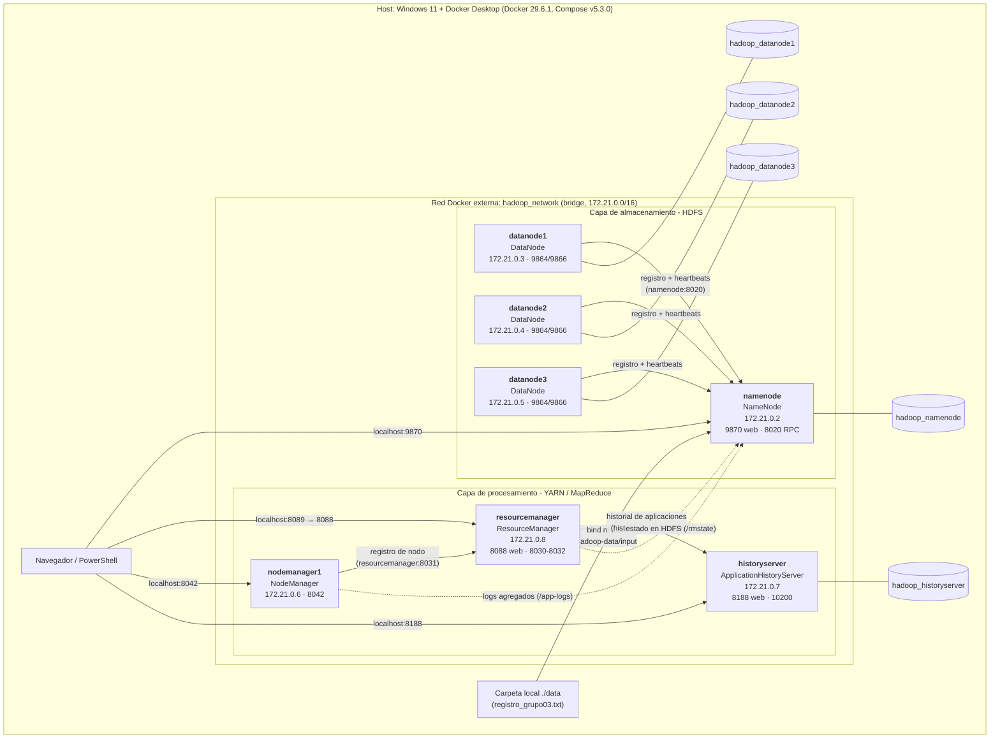
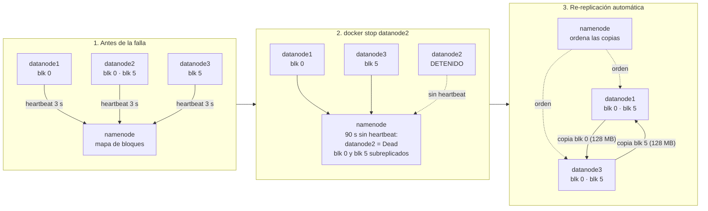

# Arquitectura de hadoop-environment (Grupo 03 - LG14 y LG15)

Este documento describe la arquitectura **real** del repositorio
[spraharaj-projects/hadoop-environment](https://github.com/spraharaj-projects/hadoop-environment),
tal como quedó desplegada por el grupo. Los datos (IPs, nombres de volúmenes, procesos) salen de
las evidencias en [`evidencias/salidas/`](../evidencias/salidas/) y [`evidencias/lg15/`](../evidencias/lg15/).

La infraestructura es la misma en las dos prácticas. Para LG15 solo cambió `hdfs-site.xml`
(factor de replicación **2** y detección de DataNodes muertos en **90 s**); el detalle está en la
sección [Configuración de LG15](#configuración-de-lg15-replicación-y-tolerancia-a-fallos).

## Diagrama



> Las IPs son las que Docker asignó en esta ejecución (`evidencias/salidas/04_red_hadoop_network.txt`);
> pueden cambiar si se recrea la red.

## Contenedores

El clúster tiene **7 contenedores**, cada uno ejecuta un único demonio de Hadoop. Todas las imágenes
se construyen localmente: primero la imagen base `hadoop-base:3.3.6` (desde el `Dockerfile` de la raíz)
y luego una imagen por servicio que hereda de ella.

| Contenedor | Imagen construida | Proceso Java principal | Función |
|---|---|---|---|
| `namenode` | `hadoop-environment-namenode` | `hdfs.server.namenode.NameNode` | Maestro de HDFS: guarda el espacio de nombres (directorios, archivos) y el mapa de qué bloques están en qué DataNode. Formatea su directorio la primera vez que arranca. |
| `datanode1` | `hadoop-environment-datanode1` | `hdfs.server.datanode.DataNode` | Almacena físicamente los bloques de HDFS y reporta su estado al NameNode. |
| `datanode2` | `hadoop-environment-datanode2` | `hdfs.server.datanode.DataNode` | Igual que `datanode1`. |
| `datanode3` | `hadoop-environment-datanode3` | `hdfs.server.datanode.DataNode` | Igual que `datanode1`. |
| `resourcemanager` | `hadoop-environment-resourcemanager` | `yarn.server.resourcemanager.ResourceManager` | Maestro de YARN: recibe trabajos (MapReduce) y asigna CPU/memoria de los NodeManager. |
| `nodemanager1` | `hadoop-environment-nodemanager1` | `yarn.server.nodemanager.NodeManager` | Ejecuta los contenedores de cómputo que asigna el ResourceManager. |
| `historyserver` | `hadoop-environment-historyserver` | `yarn.server.applicationhistoryservice.ApplicationHistoryServer` | Timeline/Application History Server: guarda el historial de las aplicaciones YARN terminadas. |

Los procesos se verificaron con `ps` dentro de cada contenedor. Cada contenedor arranca con `CMD ["/run.sh"]`,
y el `run.sh` de cada carpeta lanza el demonio correspondiente (`hdfs namenode`, `hdfs datanode`,
`yarn resourcemanager`, `yarn nodemanager`, `yarn historyserver`).

## Puertos

| Contenedor | Puerto interno | Publicado en el host | Uso |
|---|---|---|---|
| `namenode` | 9870 | `localhost:9870` | Interfaz web del NameNode (estado, DataNodes, explorador de archivos) |
| `namenode` | 8020 | `localhost:8020` | RPC de HDFS (`fs.defaultFS = hdfs://namenode:8020`) |
| `datanode1..3` | 9864 | No publicado | Interfaz web de cada DataNode (solo dentro de la red) |
| `datanode1..3` | 9866 | No publicado | Transferencia de bloques entre clientes y DataNodes |
| `resourcemanager` | 8088 | `localhost:8089` | Interfaz web de YARN (se mapea a 8089 en el host) |
| `resourcemanager` | 8030 / 8031 / 8032 | No publicado | Scheduler, registro de NodeManagers y envío de aplicaciones |
| `nodemanager1` | 8042 | `localhost:8042` | Interfaz web del NodeManager |
| `historyserver` | 8188 | `localhost:8188` | Interfaz web del historial de aplicaciones |
| `historyserver` | 10200 | No publicado | RPC del Application History Server |

## Redes

Una sola red: **`hadoop_network`**, de tipo bridge, declarada como `external: true` en el
`docker-compose.yml`. Por eso **debe crearse antes** de levantar el clúster
(`docker network create hadoop_network`); Compose no la crea. Dentro de la red los contenedores se
encuentran por nombre (`namenode`, `resourcemanager`, `historyserver`), que es lo que usan los XML de
configuración.

## Volúmenes

| Volumen (nombre real) | Contenedor | Ruta interna | Contenido |
|---|---|---|---|
| `hadoop-environment_hadoop_namenode` | `namenode` | `/hadoop/dfs/name` | Metadatos de HDFS (fsimage y edits) |
| `hadoop-environment_hadoop_datanode1` | `datanode1` | `/hadoop/dfs/data` | Bloques de HDFS del nodo 1 |
| `hadoop-environment_hadoop_datanode2` | `datanode2` | `/hadoop/dfs/data` | Bloques de HDFS del nodo 2 |
| `hadoop-environment_hadoop_datanode3` | `datanode3` | `/hadoop/dfs/data` | Bloques de HDFS del nodo 3 |
| `hadoop-environment_hadoop_historyserver` | `historyserver` | `/hadoop/yarn/timeline` | Base de datos del historial de aplicaciones |

Además, el `namenode` tiene dos **bind mounts** a carpetas del host:

| Carpeta del host | Ruta interna | Uso |
|---|---|---|
| `./data` | `/hadoop-data/input` | Archivos locales para cargar a HDFS (aquí se usó `registro_grupo03.txt`) |
| `./map_reduce` | `/hadoop-data/map_reduce` | Pensada para scripts de MapReduce (no se usó en LG14) |

Gracias a los volúmenes con nombre, los datos de HDFS sobreviven a `docker compose down`; solo se borran
con `docker compose down -v`.

## Dependencias entre servicios (`depends_on`)

```text
namenode
├── datanode1, datanode2, datanode3          (dependen de namenode)
├── resourcemanager                          (depende de namenode y de los 3 datanodes)
├── nodemanager1                             (depende de namenode, datanode1 y datanode2)
└── historyserver                            (depende de namenode, datanode1 y datanode2)
```

`depends_on` solo controla el **orden de arranque**, no espera a que el servicio esté listo. El único
servicio con política de reinicio es `resourcemanager` (`restart: on-failure`), que es el que puede
fallar si arranca antes de que HDFS acepte conexiones. Cada imagen define un `HEALTHCHECK` con `curl`
contra su puerto web; por eso `docker ps` muestra `(healthy)`.

## Variables de entorno

| Dónde | Variable | Valor | Para qué |
|---|---|---|---|
| `docker-compose.yml` (namenode) | `CLUSTER_NAME` | `test` | Nombre del clúster al formatear el NameNode (`run.sh` falla si no existe) |
| `Dockerfile` base | `JAVA_HOME` | `/usr/local/openjdk-11` | Java que usa Hadoop |
| `Dockerfile` base | `HADOOP_VERSION` | `3.3.6` | Versión descargada |
| `Dockerfile` base | `HADOOP_HOME` / `HADOOP_PREFIX` | `/opt/hadoop-3.3.6` | Instalación de Hadoop |
| `Dockerfile` base | `HADOOP_CONF_DIR` | `/etc/hadoop` | Carpeta de los XML de configuración |
| `Dockerfile` base | `MULTIHOMED_NETWORK` | `1` | Heredada de otras imágenes; aquí los XML ya fijan `bind-host = 0.0.0.0` |
| `Dockerfile` base | `USER` | `root` | Usuario con el que corren los demonios |
| `namenode/Dockerfile` | `HDFS_CONF_dfs_namenode_name_dir` | `file:///hadoop/dfs/name` | Leída por `run.sh` para validar y formatear el directorio |
| `datanode/Dockerfile` | `HDFS_CONF_dfs_datanode_data_dir` | `file:///hadoop/dfs/data` | Leída por `run.sh` para validar el directorio de datos |
| `historyserver/Dockerfile` | `YARN_CONF_yarn_timeline___service_leveldb___timeline___store_path` | `/hadoop/yarn/timeline` | Ruta del almacén del historial |

A diferencia de `docker-hadoop`, aquí las variables `HDFS_CONF_*` **no** generan los XML: la
configuración real está en los archivos de `conf/`, que se copian a la imagen base.

## Archivos de configuración

| Archivo | Propiedades principales |
|---|---|
| [`conf/core-site.xml`](../hadoop-environment/conf/core-site.xml) | `fs.defaultFS = hdfs://namenode:8020`, usuario web `root`, códec Snappy |
| [`conf/hdfs-site.xml`](../hadoop-environment/conf/hdfs-site.xml) | Directorios de NameNode y DataNode, WebHDFS activo, permisos desactivados, `bind-host = 0.0.0.0`, uso de hostnames entre DataNodes. Para LG15: `dfs.replication = 2` y `dfs.namenode.heartbeat.recheck-interval = 30000`. En LG14 no se definía `dfs.replication` y se usaba el valor por defecto (**3**). El tamaño de bloque es el por defecto: **128 MB**. |
| [`conf/yarn-site.xml`](../hadoop-environment/conf/yarn-site.xml) | ResourceManager en `resourcemanager`, recuperación con estado en HDFS (`/rmstate`), Capacity Scheduler, Timeline Service en `historyserver`, NodeManager declarado con 16 GB y 8 vCores, logs agregados en `/app-logs` |
| [`conf/mapred-site.xml`](../hadoop-environment/conf/mapred-site.xml) | MapReduce sobre YARN, memoria de map (4 GB) y reduce (8 GB), `HADOOP_MAPRED_HOME` |
| [`Dockerfile`](../hadoop-environment/Dockerfile) | Imagen base: JDK 11 (Temurin) + Python 3.11 (Debian 12) + Hadoop 3.3.6 + copia de `conf/` |
| [`docker-compose.yml`](../hadoop-environment/docker-compose.yml) | Los 7 servicios, puertos, volúmenes, red externa y dependencias |
| `*/Dockerfile` y `*/run.sh` | Imagen y script de arranque de cada servicio |

## Observaciones de arquitectura

- **Un demonio por contenedor.** El NameNode y el ResourceManager están separados, igual que cada
  DataNode. Es un diseño de microservicios, distinto a un clúster físico donde un mismo nodo suele
  correr DataNode y NodeManager a la vez.
- **El NodeManager no comparte contenedor con ningún DataNode.** Por eso, al ejecutar MapReduce, no hay
  localidad de datos: las tareas siempre leen los bloques por red.
- **3 DataNodes con replicación 3 en LG14.** Cada bloque se copiaba en los tres nodos (se ve en
  `11_hdfs_fsck_registro.txt`: `Live_repl=3` en 172.21.0.3, .4 y .5). Si un DataNode caía, no quedaba
  ningún nodo libre donde reponer la réplica que faltaba. Por eso en LG15 se bajó el factor a 2.
- **Recursos declarados mayores que los reales.** `yarn-site.xml` anuncia 16 GB y 8 vCores para el único
  NodeManager, sin importar la memoria real de Docker Desktop.

## Configuración de LG15: replicación y tolerancia a fallos

| Propiedad (`hdfs-site.xml`) | Valor | Efecto |
|---|---|---|
| `dfs.replication` | `2` | Cada bloque de 128 MB tiene 2 réplicas en DataNodes distintos. Con 3 DataNodes, si uno cae siempre queda un nodo vivo sin ese bloque donde reponer la réplica |
| `dfs.namenode.heartbeat.recheck-interval` | `30000` (30 s) | Un DataNode se declara muerto tras `2 × 30 s + 10 × 3 s` = **90 s** sin heartbeats (por defecto serían 10,5 min) |

Estructura en HDFS usada en LG15:

```text
/grupo03/
├── dataset_1GB/dataset_grupo03_1GB      1 GB  →  8 bloques × 2 réplicas
├── dataset_10GB/dataset_grupo03_10GB    10 GB → 80 bloques × 2 réplicas
├── resultados/                          resúmenes finales de las pruebas
└── evidencias/                          salidas de comandos y capturas
```

### Diagrama de la prueba de fallo

Ejemplo con dos bloques reales del dataset de 1 GB
([`1GB_02_antes_fsck.txt`](../evidencias/lg15/1GB_02_antes_fsck.txt) y
[`1GB_despues.txt`](../evidencias/lg15/1GB_despues.txt)). El bloque 0 tenía sus réplicas en
`datanode2` y `datanode1`; el bloque 5, en `datanode3` y `datanode2`.



- **Lectura durante la falla.** El cliente pide al NameNode las ubicaciones de cada bloque y lee
  directamente de los DataNodes. Si la réplica de `datanode2` no responde, usa la otra; por eso el md5
  del archivo nunca cambió.
- **Re-replicación.** La decide el NameNode: con 3 nodos, factor 2 y uno caído, el destino es siempre
  el único nodo vivo que no tiene el bloque. La copia la hacen los DataNodes entre sí por el puerto 9866.
- **Restauración.** Al volver `datanode2`, sus réplicas antiguas sobran (3 copias) y el NameNode borra
  las sobrantes. HDFS no rebalancea automáticamente; para eso existe `hdfs balancer`.

Los resultados completos (bloques afectados, tiempos y nuevas réplicas) están en la sección 8 del
[README](../README.md#8-lg15--tolerancia-a-fallos-y-replicación-de-datos-en-hdfs).
